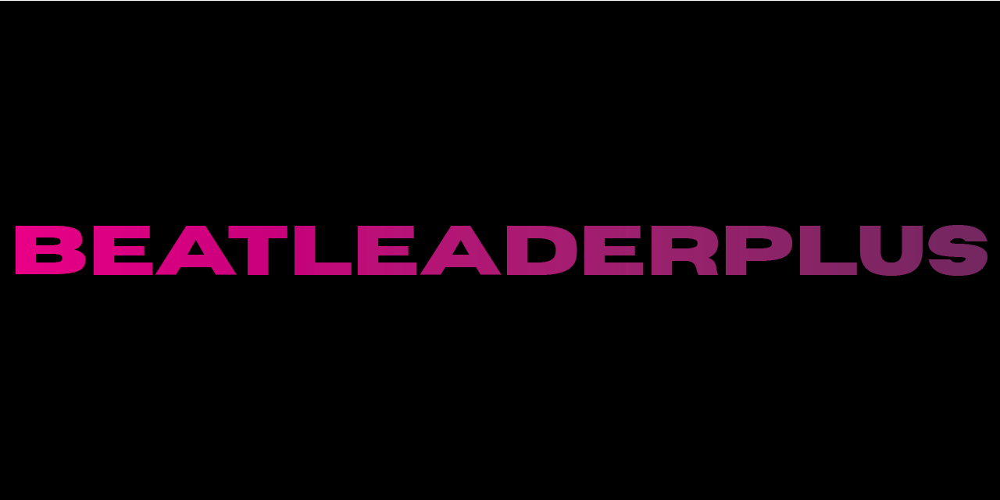

	

A Chrome extension that adds more options to the [BeatLeader](https://beatleader.com) website and its web replay viewer. In the replayer it adds to the menus that are already there instead of adding a second interface.

> Unofficial, fan-made extension. Not affiliated with or endorsed by BeatLeader.

## Install

1. Download this repository (**Code → Download ZIP**) and unzip it.
2. Open `chrome://extensions` and turn on **Developer mode** (top right).
3. Click **Load unpacked** and pick the folder that contains `manifest.json`.

Works in Chrome 111 or newer and other Chromium browsers (Edge, Brave, Opera). To update, replace the folder and click the reload icon on the extension's card.

## How to use it

**Replay viewer:** open any replay, then press `` ` `` or open Settings and pick the **BL+** tab. Camera options are in the camera menu's **BL+** tab. Screenshots and clips are in the right-click menu.

**Website:** click the **BL+** button on profile and leaderboard pages. Drag it to any edge of the window to move it.

**All settings:** click the extension icon, then **All options**. Changes apply right away.

## Features

### Replay viewer: camera

| Feature | What it does |
| --- | --- |
| First person camera | Turn the replayer's first-person view on or off from Camera → BL+ or the Main camera tab. Its field of view, Z position offset, X rotation offset, "force look upright" and "stay in first person" settings are shown there too and stay in sync with its FPV tab. |
| First person extras | Height offset, side offset, head smoothing and a level horizon that ignores head tilt. |
| Orthographic views | Turn the replayer's top, right and back views on or off, with their zoom and render distance. |
| Free camera tuning | Move speed, `Shift` to sprint and mouse capture for the replayer's own WASD camera. |
| Field of view and smoothing | Field of view for the free camera and how smoothly BL+ camera moves glide. |
| Orbit camera | Circles the player's head or the middle of the play area, with radius, height, speed and start angle. |
| Smooth follow camera | Follows the head or the play area with lag, look-ahead and an adjustable offset. |
| Camera presets | Named camera setups with their own hotkeys. Five come built in (`Shift+1` to `Shift+5`), and you can save the current view as a new one. |
| Camera on load | Start every replay in a chosen camera mode or preset, or in the last mode you used. |
| Camera paths | Record a camera move (`Shift+G`) or add keyframes (`Alt+G`), then play it back smoothly (`G`). Paths can loop, be renamed, exported, imported and shared as a link. |

### Replay viewer: look

| Feature | What it does |
| --- | --- |
| Note colors | Separate colors for left and right notes, chains and arcs, independent of the saber colors. |
| Note size | 50–150% for notes, bombs and chains. |
| Wall opacity | Make walls see-through, 0–100%. |
| Trails | Trail color (matching the saber or custom), width and brightness. |
| Saber glow | How strongly the sabers glow. |
| Saber styles | Default, neon, particle or a custom model. |
| Custom saber models | Drop a Beat Saber `.saber` file, or a `.glb`, `.gltf` or `.obj` model, onto Settings → BL+. Scale, rotation, saber-color tint and hiding the default blade are adjustable, and saved models can be reused. |
| Mistake flashes | A screen flash on misses, bad cuts and bombs, in your colors and strength. |
| Mistake markers | A 3D ring, cross or pillar where each mistake happened. |
| Hit particles | Sparks on every cut, colored by saber, a custom color or accuracy. |
| Accuracy heat | Tints each note by the score it gets in the replay (`Alt+Shift+A`). |
| Show or hide | Each saber, the trails, notes, bombs, walls, arcs and chains. |
| Picture | Brightness, contrast and saturation. Screenshots and clips get the same look. |
| Website theme in the replayer | Use your website font and custom CSS in the replay viewer as well. |

### Replay viewer: playback

| Feature | What it does |
| --- | --- |
| Frame stepping | `[` and `]` move one frame back or forward, by recorded frame or a fixed step. |
| Reverse playback | `Z` plays backwards, with adjustable rate and speed. |
| A-B loop | `T` sets A, then B, then clears the loop (`Shift+T` clears it). Optional pre-roll. |
| Bookmarks | `B` adds a bookmark and `Shift+B` jumps to the next one. Bookmarks have notes, are saved per replay, appear on the timeline and are listed in the options. |
| Pause at mistakes | Stops at each miss, bad cut, bomb or wall hit. Each type can be turned on or off. |
| Speed buttons | One-click speeds in Settings → BL+ (0.5×, 0.75×, 1× and 1.25× by default, editable). |
| Low-accuracy slow motion | Cuts below a score you choose slow down like mistakes. Turning it on also turns on the replayer's "Change speed around mistakes". |
| Remember speed and jump distance | Keeps the speed and jump distance you set for the next replay. |
| Playlist next / previous | `Alt+Shift+→` and `Alt+Shift+←` go to the next or previous replay in a playlist. |

### Replay viewer: score HUD and interface

| Feature | What it does |
| --- | --- |
| PP estimate | Shows the estimated PP in the 3D score HUD (ranked maps). |
| Last cut score | Shows the last cut's score with its swing and accuracy points. |
| HUD size and height | Makes the score HUD bigger or smaller and moves it up or down. |
| HUD color | Your own color for the HUD text. |
| HUD parts | Show or hide the score, accuracy, combo, multiplier, misses and energy bar. |
| Hide replayer elements | Hide the song info, player info, Discord and Patreon corners or the playlist panel. |
| Hide all BL+ overlays | `Alt+Shift+H` hides everything BeatLeaderPlus draws at once. |
| BL+ menus | BL+ tabs in the replayer's Settings and Camera menus and extra right-click menu entries. `` ` `` opens Settings → BL+. |

### Replay viewer: sound

| Feature | What it does |
| --- | --- |
| Extra hitsounds | Sounds for bad cuts, misses and bomb hits, each with its own sound and volume. |
| Built-in sounds | Click, tick, chime, buzz, thud and boom. |
| Hitsound packs | Import a folder, files or a `.zip` of `.mp3`, `.ogg` or `.wav` sounds. They're matched to the right slots by file name. |

### Replay viewer: export and sharing

| Feature | What it does |
| --- | --- |
| Share link | `Alt+Shift+C` or the right-click menu copies a link with the time, speed, jump distance, camera and colors. You choose what to include. |
| Screenshots | `F9` or the right-click menu, at any resolution, as PNG, JPEG or WebP. |
| Clip recording | `F8` or the right-click menu records a `.webm` video, with adjustable length, resolution, frame rate and bitrate, and optional song audio. |
| Export | Save camera paths or all your settings as a file. |
| Link options | Links can open a camera preset, camera mode or camera path, or open Settings → BL+ (`blpCam`, `blpMode`, `blpPath`, `blpPanel`). |

### Website

| Feature | What it does |
| --- | --- |
| Theme editor | 14 colors, including the rank #1, #2 and #3 colors. |
| Theme presets | Dark+, OLED Black, Light, High Contrast and Custom, with a live preview. |
| Fonts | Font family, size and weight. |
| Density and layout | Density, compact mode and corner roundness. |
| Hide page elements | Header, footer, sidebars, social links, ads, banners, avatars, headset icons, flags, background images and cinematics, or anything you pick with your own selectors. |
| Custom CSS | Add your own CSS to the site. |
| Replay download | A `.bsor` download button next to replay links, and in the right-click menu. |
| Score comparison | Pick two scores to compare accuracy, PP, rank, mistakes, pauses, combo, per-hand accuracy, modifiers, headset and date side by side. |
| Quick filters | My scores, my clan, high accuracy, favorites and full combo. |
| Auto-expand score details | Opens score details automatically. |
| Extra badges | Misses, bad cuts, pauses and max combo shown on scores. |
| Favorites | Favorite players and maps, with notes, from the BL+ button or optional stars next to links. Players are saved by their player ID. |
| Followed players | Checks for new scores on a schedule, with a toolbar badge and desktop notifications. Clicking a notification opens the replay. |
| Profile statistics | Average and median accuracy, FC rate, average stars, accuracy spread, personal bests over time and recent trend. |
| BL+ dock | Collapses to a BL+ button, can be dragged to any edge, and has a size setting. |
| Page shortcuts | `Alt+Shift+→` and `Alt+Shift+←` change pages, `Alt+Shift+T` turns the theme on or off. |

### Popup and options

| Feature | What it does |
| --- | --- |
| Popup | Quick toggles you choose, replay buttons (copy link, screenshot, record clip, open BL+ settings, camera mode and preset), new scores from followed players and your favorites. Its size and sections can be changed. |
| Options page | Every setting in one searchable page, with live previews of the theme and visuals. |
| Live updates | Changes apply straight away to open tabs, including a playing replay. |
| Keyboard shortcuts | Every shortcut can be changed, with a warning when two clash. |
| Per-site settings | Different settings for each BeatLeader site if you want them. |
| Backup | Export and import all settings as a file, optionally with hitsound packs and saber models. |
| Reset | Reset one section or everything. |
| Saved data | Manage bookmarks, camera paths, saber models, hitsound packs, favorites and followed players. |
| Language | English and German, picked automatically or by hand. |
| Notifications and debug | Turn BL+ notifications on or off, and turn on debug logging. |

## Shortcuts

| Action | Key |
| --- | --- |
| Open Settings → BL+ | `` ` `` |
| Cycle camera (official, orbit, follow, first person) | `V` |
| Camera presets | `Shift+1` to `Shift+5` |
| Play / record camera path, add keyframe | `G` / `Shift+G` / `Alt+G` |
| Frame back / forward | `[` / `]` |
| Reverse playback | `Z` |
| A-B loop (set A, set B, clear) / clear loop | `T` / `Shift+T` |
| Add bookmark / next bookmark | `B` / `Shift+B` |
| Screenshot / record clip | `F9` / `F8` |
| Copy share link | `Alt+Shift+C` |
| Accuracy heat | `Alt+Shift+A` |
| Hide BL+ overlays | `Alt+Shift+H` |
| Turn the website theme on or off | `Alt+Shift+T` |
| Next / previous page or replay | `Alt+Shift+→` / `Alt+Shift+←` |
| Open the popup / options | `Alt+Shift+B` / `Alt+Shift+O` |

Every shortcut can be changed in **Options → Keyboard shortcuts**.

## Privacy

BeatLeaderPlus only talks to the BeatLeader API, and only for the features you use. Your settings and data stay in your browser.

## More

Every option in detail, how the extension works and how to contribute are in the [full documentation](README-old.md).
